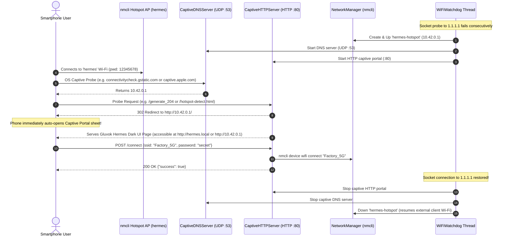

# wifi-nmcli

> Pure `nmcli` (NetworkManager) Wi-Fi Manager, Flap-Debounced Watchdog, and Mobile Captive Portal for Linux Edge Devices & Raspberry Pi.

---

## 🚀 Overview

`wifi-nmcli` provides an automated Wi-Fi fallback and captive portal system powered directly by **Linux NetworkManager (`nmcli`)**, completely eliminating any dependency on external closed binaries such as `balena-io/wifi-connect`.

When network connectivity is lost, the background watchdog automatically creates an emergency Wi-Fi Access Point (`hermes`), spins up a built-in DNS interception resolver and HTTP server, and serves the exact same mobile-optimized dark configuration portal on connecting smartphones.

---

## ⚡ Key Highlights: Why `nmcli` over Balena?

| Feature | `balena-io/wifi-connect` | `wifi-nmcli` |
| :--- | :--- | :--- |
| **External Dependencies** | Requires pre-compiled Rust binary download via curl/github | **Zero external binaries** — uses native `nmcli` pre-installed on Linux |
| **Architecture Compatibility** | Binary mismatch risks (ARMv6, ARMv7hf, aarch64, musl vs glibc) | **100% Universal** across all CPU architectures supporting NetworkManager |
| **Captive Portal Engine** | Embedded Actix Web server in Rust | **Pure Python standard library** (`http.server` + UDP DNS resolver) |
| **DNS Redirection** | Requires system `dnsmasq` manipulation | **Built-in Python Captive DNS** resolving OS probes seamlessly |
| **Watchdog Integration** | External wrapper monitoring exit codes | **Native flap-debounced daemon thread** with backoff and state machines |
| **Local Development / CI** | Fails or errors on non-Linux OS | **Built-in simulation mode** for testing on macOS and CI |

---

## 📱 Mobile Captive Portal Workflow



---

## 🛠 Project Structure

Adhering to NASA JPL Rule 4 (compact single-purpose files ≤ 60 lines each):

```
wifi nmcli/
├── pyproject.toml              # uv & project configuration
├── README.md                   # Complete documentation & guide
├── wifi_setup.py               # Standalone runner entrypoint
├── src/
│   └── wifi_nmcli/
│       ├── __init__.py         # Package exports
│       ├── cli.py              # CLI parser and command handlers
│       ├── core/
│       │   ├── constants.py    # SSIDs, passwords, gateway IPs, intervals
│       │   └── vault.py        # SQLite persistent vault for saved networks
│       ├── nmcli/
│       │   ├── runner.py       # nmcli runner with simulation state fallback
│       │   ├── ip.py           # Hotspot interface IP detection
│       │   ├── hotspot.py      # Hotspot AP creation, status & teardown
│       │   ├── scanner.py      # nmcli Wi-Fi network scanner & deduplication
│       │   └── connection.py   # Client Wi-Fi connect & disconnect
│       ├── portal/
│       │   ├── dns_server.py   # UDP DNS captive interception (port 53)
│       │   ├── handlers.py     # HTTP endpoints (/networks, /saved, /connect, probes)
│       │   ├── http_server.py  # Threaded HTTP captive server lifecycle
│       │   ├── service.py      # Unified DNS + HTTP portal coordinator
│       │   └── templates/
│       │       └── index.html  # Mobile responsive Gluvok dark config UI
│       └── watchdog/
│           ├── connectivity.py # Socket probe (1.1.1.1:53, 8.8.8.8:53)
│           ├── lifecycle.py    # Thread-safe watchdog start / stop controls
│           └── monitor.py      # Flap-debounced background monitoring loop
└── tests/
    ├── test_nmcli.py           # Scanner, connection, and vault tests
    ├── test_portal.py          # Captive DNS & HTTP endpoint tests
    └── test_watchdog.py        # Flap debouncing and recovery tests
```

---

## 💻 Installation & Usage

### 1. Requirements

* Linux (Debian, Ubuntu, Raspberry Pi OS) with `NetworkManager` (`nmcli`)
* Python `>= 3.10`
* (Optional) `uv` for modern package management

### 2. Run with `uv`

```bash
# Scan nearby Wi-Fi access points
uv run wifi-nmcli --scan

# Connect to a network
uv run wifi-nmcli --connect --ssid "MyOfficeNetwork" --password "MyPassword"

# Manually activate the emergency hotspot and captive portal
uv run wifi-nmcli --hotspot

# Run background watchdog monitor (auto fallback on disconnect)
uv run wifi-nmcli
```

Or via direct python invocation:
```bash
python3 wifi_setup.py
```

---

## 🧪 Testing

Run the test suite and linter:
```bash
uv run pytest
uv run ruff check
```

---

## ⚙️ Running as a Systemd Service

To run automatically in the background on your Raspberry Pi:

1. Create `/etc/systemd/system/wifi-watchdog.service`:
```ini
[Unit]
Description=Hermes nmcli Wi-Fi Watchdog & Captive Portal
After=network.target NetworkManager.service
Wants=NetworkManager.service

[Service]
Type=simple
User=root
WorkingDirectory=/path/to/wifi nmcli
ExecStart=/usr/bin/python3 wifi_setup.py
Restart=always
RestartSec=5

[Install]
WantedBy=multi-user.target
```

2. Enable and start:
```bash
sudo systemctl daemon-reload
sudo systemctl enable wifi-watchdog.service
sudo systemctl start wifi-watchdog.service
```
